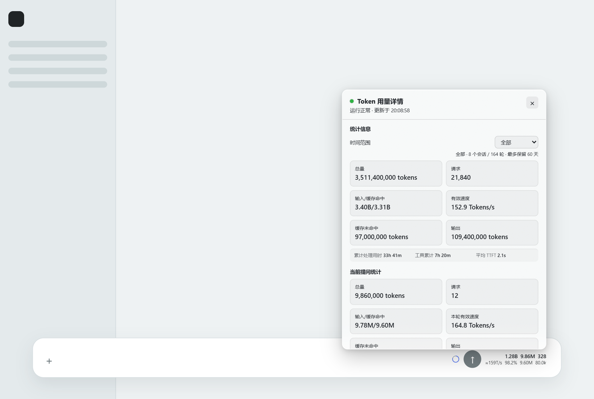
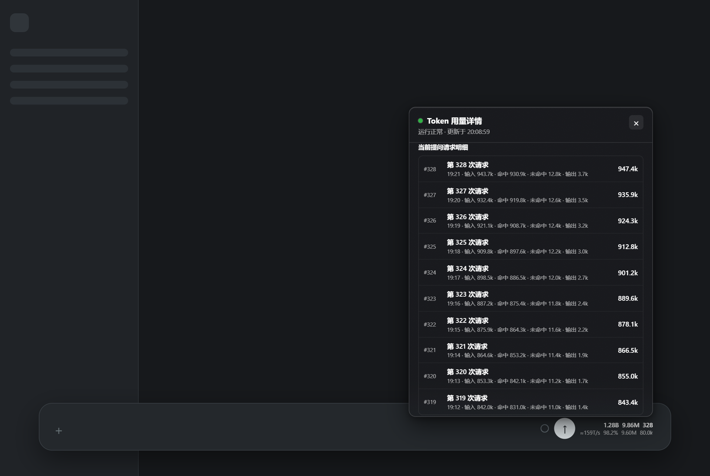
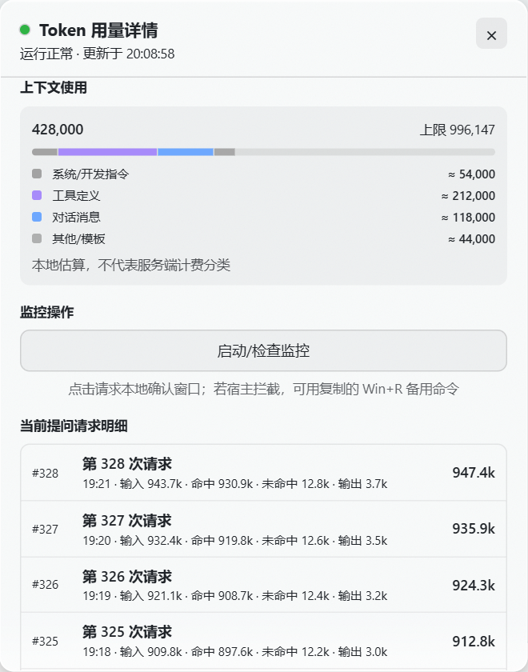

# Tokens UI For Codex

Native-style token usage UI for the Codex desktop app. A compact bar sits immediately
left of the context-usage ring in the composer; left-click it to open a detailed dialog.

- Author: **Littps**
- Platform: Windows 10 / 11
- Client: Codex / ChatGPT desktop
- Dependency: Codex++ user scripts
- License: MIT

The project does not patch Codex's React bundle, register keyboard listeners, or display
message text, session paths, or thread IDs.

## UI

The screenshots use synthetic, non-sensitive demo data generated from the current build.







```text
Session  Current question  Requests
≈Speed   Hit rate          Hits      Output
```

The compact bar shows:

- Session total
- Current-question total
- Session request count
- Robust estimated generation speed as `≈XXXT/s`
- Current-question cache hit rate
- Cache-hit tokens
- Current-question output tokens

The bar freezes while the pointer is over it and catches up immediately after the pointer leaves.

Clicking the bar opens six sections:

| Section | Contents |
| --- | --- |
| Statistics | lazy-load today / 3 days / 7 days / 30 days / all local history; tokens, requests, input/cache hits, range speed, misses, output and timing |
| Current question | tokens, requests, input/cache hits, current-turn effective speed, misses, output; turn wall time, tool time and TTFT |
| Context usage | exact used/limit values; optional local category estimate with full integers and a segmented bar |
| Monitor controls | manual launch and security notices; the header health dot exposes diagnostics on hover/focus |
| Current-question requests | latest 10; Load more adds 20; cap 500 |
| Turn summaries | latest 10; Load more adds 50; cap 500 |

Both lists are newest-first. Hidden rows are not included in the page payload.
The page, monitor protocol and receiver are all capped at **500** rows. Older structured
request and turn records are written to a local history archive and never sent over CDP.

“Statistics” can lazy-load today, the last 3 days, the last 7 days, the last 30 days,
or all locally archived history. The selection defaults to “all” and is persisted.
Opening the dialog paints the latest cached range summary immediately (24-hour cache), then
replaces it with the next signed payload. The last expanded turn/request snapshot is also
retained for the current page session.
“All” is bounded by the 60-day local retention window. See
[docs/history-ranges.md](docs/history-ranges.md).

The compact “session” value is the complete thread cumulative value. The detailed
“all” value is the sum of dated turns retained in the local 60-day archive. A legacy
baseline before the first observable log entry has no reliable date, so the two
values are not required to match. See `docs/metric-scopes.md`.

Additional behavior:

- Close by clicking outside or the top-right `×`; closing uses a 110ms exit animation
- No keyboard listeners; Esc does not close the dialog
- Light/dark theme follows the Codex host and updates after a short debounce
- High-performance devices use the stronger frosted profile; slow devices and reduced-transparency settings fall back automatically
- Health dot: green healthy, yellow waiting/stale, red error; hover or focus shows the
  error code, reason, recovery state, CDP/page state and last success time

Context categories are local estimates, not provider billing data. System/developer
instructions, tool definitions, messages and other/template overhead are estimated
separately. When a source is unavailable, its category displays `--`. See
[docs/context-estimation.md](docs/context-estimation.md).
If unclassified content exceeds 60%, the category UI is hidden and only the exact
used/limit values remain visible.

## Context behavior

- Context usage is derived from the final request's `usage.total_tokens`, capped by the model limit.
- The limit is discovered from `task_started`, `token_count`, and session metadata.
- System/developer instructions, tool definitions, messages, and other/template overhead are local estimates.
- Missing sources show `--`; estimates are never presented as provider billing categories.
- If other/template overhead exceeds 60%, unreliable category details are hidden.
- Only numeric weights exist in parsed state and payloads; message text, paths, and raw IDs are not sent.

See [docs/context-estimation.md](docs/context-estimation.md) and
[docs/context-and-resources.md](docs/context-and-resources.md).

## Original component-mode resources

The current implementation uses a resident PowerShell watchdog plus the Node monitor:

| Process | Observed working set |
| --- | ---: |
| PowerShell watchdog | about 90–120 MB |
| Node monitor | about 140–160 MB |
| Total | about 230–280 MB |

These are representative measurements from one Windows machine on 2026-11-01, not a
cross-device SLA. Idle CPU is generally near zero and rises briefly during startup,
first parsing, or full-session recalculation. Long lists are windowed, and older data
stays in the local 60-day archive.

The repository also contains an experimental `rust-launcher/` 0.1.0 Alpha component.
It replaces only the PowerShell watchdog and still starts the same Node monitor. The
standard installation package keeps the PowerShell watchdog and does not switch
automatically. The Rust launcher has passed isolated lifecycle, scheduled-task
install/uninstall and doctor tests; see [rust-launcher/README.md](rust-launcher/README.md).
**The Rust version has not received detailed testing**: only build, automated
isolation, short local scheduled-task and resource tests are complete. Multi-device,
long-duration, sleep/resume, network-failure, enterprise-policy and upgrade matrices
remain unverified.

## Requirements

| Dependency | Requirement |
| --- | --- |
| OS | Windows 10 / 11 |
| Codex | Desktop app, MSIX or conventional installation |
| Codex++ | Installed, user scripts enabled |
| Node.js | 22+; the Codex bundled runtime is preferred when available |
| PowerShell | Windows PowerShell 5.1 or PowerShell 7 |
| Admin rights | Not required |

Node discovery collects every `node.exe` candidate from `PATH`, the Codex runtime and
common install locations, ignores `.cmd` shims and versions below 22, then chooses the
highest compatible version. Installation stops with a clear message if none qualifies.

## Project dependencies and build

There are no third-party runtime npm dependencies. The monitor uses only Node.js built-ins:

- `fs`, `path`, `os`
- `crypto` for HMAC-SHA256 and session hashes
- `child_process`
- built-in WebSocket and fetch in Node 22+

No `npm install` is required for deployment. Development verification uses Node.js 22/24,
Windows PowerShell 5.1/PowerShell 7. Playwright is used for local auth UI tests and
`npm run test:live`. CI runs
unit tests on both Node 22 and Node 24.

## Install

See [DEPLOYMENT.md](DEPLOYMENT.md) for the release-package layout, verification and uninstall steps.

```powershell
powershell.exe -NoProfile -ExecutionPolicy Bypass -File ".\install.ps1"
```

The installer:

1. Verifies Windows, Node, Codex, Codex++, the user-script switch and the `codex` CLI
2. Stops the old monitor before replacing the panel
3. Backs up and installs the Codex++ user script with SHA-256 verification
4. Retires older panel scripts by content so only one bar is injected
5. Registers `tokens-ui-for-codex@tokens-ui-for-codex-local`
6. Registers a per-user scheduled task and starts the monitor once
7. Rechecks required components and returns non-zero on failure

Source archives do not need a prebuilt `plugins/` tree. The installer validates a
fresh staging layout and switches it into
`<CODEX_HOME>\tokens-ui-for-codex\install-stage\` before registration.

## Startup

Scheduled task: `tokens-ui-for-codex-monitor`

- Starts once at user logon
- Action chain: `powershell.exe -WindowStyle Hidden → monitor-watchdog.ps1 -Resident`
- The watchdog stays resident and checks the monitor every 15 seconds
- Task `IgnoreNew`, a user guard lock and process auditing prevent duplicate monitors
- Hung detection uses a startup grace period and two consecutive stale observations
- An in-place-upgrade monitor without valid heartbeat identity is migrated once after startup grace
- Failed starts back off for 1, 2, 5, 10 and 15 minutes
- Per-user Limited principal; no UAC

By default only one monitor may run for a Windows user. Different state or lock
paths do not bypass the user guard. `--allow-multi-monitor` is test-only.

If the monitor is stopped, the watchdog restores it. Manual entry points remain available.
The dialog first requests the local confirmation protocol and also copies a Win+R
fallback command. The PowerShell confirmation window still requires `Y`.

## Data flow

```text
Codex rollout JSONL
  → incremental parser and statistics
  → local CDP with dynamic port discovery
  → signed schema v4 / auth v2 payload
  → HMAC verification in the Codex++ script
  → incremental bar/dialog rendering
```

The monitor:

- Reads only structured numeric fields
- Merges all shards of a long session
- Sorts by `(timestamp, ordinal)`
- Handles truncation, half lines, same-size replacement and cumulative resets
- Uses the same multi-shard path for watch mode and one-shot `--thread`
- A conversation candidate requires a matching rollout and 2.5 seconds of stability before switching
- Deduplicates modern and legacy formats without assuming monotonic counters
- Uses full legacy fingerprints for duplicate detection
- Updates a mixed-format current turn from the turn's thread baseline

The authoritative merge contract is [docs/F1-merge-spec.md](docs/F1-merge-spec.md).

## Speed

- The compact bar displays an estimated generation speed and marks it with `≈`
- It uses the median of up to five valid request samples plus MAD outlier filtering
- Fewer than three valid samples shows `--T/s` instead of exposing a raw spike
- Three consecutive narrow-range samples can establish a new speed regime
- Generation intervals are merged before calculating active generation time
- The dialog displays effective speed: output tokens ÷ (turn duration − tool time)
- Session effective speed is weighted over the latest 25 high/medium-confidence turns
- The speed tooltip also shows the current turn's wall-clock average using output tokens only
- `output_tokens` already includes reasoning and tool-structure tokens

## Refresh cadence

| State | Behavior |
| --- | --- |
| Data changed | Push immediately |
| Task running | 1-second heartbeat |
| Idle | 5-second heartbeat |
| Expanded long lists | No heartbeat; push only on data/health/window changes |

Parsed rollout changes are still pushed while details are open, so the expanded
view does not depend on a heartbeat.

## Security and privacy

- Signed-only schema v4 / auth v2
- HMAC authenticates integrity and origin; it does not encrypt data
- Random 256-bit per-monitor session key
- HMAC-SHA256 over the payload, auth version, key ID, timestamp, nonce and sequence
- Reject missing auth, bad MAC, timestamps older than 30 seconds, nonce replay, sequence rollback and legacy schema
- The key is exposed only during one synchronous event dispatch and removed immediately after capture
- Payloads are cloned before async verification and the verified snapshot is applied
- Local CDP uses `--port auto`; `--port <n>` remains available as an override
- No paths, thread IDs, message text, credentials or API keys are included in the page payload
- The local archive also excludes message text, paths and original thread identifiers; only a session hash is used
- HMAC provides best-effort integrity, not isolation from same-user local malware

See [docs/auth-v2.md](docs/auth-v2.md) for the signed envelope and trust boundary.

## Diagnostics

```text
<CODEX_HOME>\tokens-ui-for-codex\state\
├─ logs\watch-YYYY-MM-DD.log
├─ history\sessions\<sessionHash>\
│  ├─ requests-YYYYMM*.jsonl
│  └─ turns.json
├─ monitor-health.json
├─ monitor-heartbeat.json
├─ watchdog-state.json
├─ watchdog.lock
├─ autostart-state.json
└─ last-summary.json
```

The authoritative paths are stored in `runtime-paths.json` next to the plugin.
See [docs/runtime-paths.md](docs/runtime-paths.md) for precedence and overrides.

The health file is rewritten every monitor cycle with a fresh `lastSuccessAt` and mtime.

Local history rules:

- Structured numeric fields, time labels and indexes only
- No message text, session paths, thread IDs, response IDs or turn IDs
- Retained for **60 days**
- Request files rotate at 32MB
- Cleanup runs every six hours
- Standard uninstall keeps history; `-Full` removes it

Common checks:

```powershell
Get-ScheduledTask -TaskName tokens-ui-for-codex-monitor | Format-List State
Get-CimInstance Win32_Process -Filter "Name='node.exe'" |
  Where-Object { $_.CommandLine -match 'token-stats\.mjs' } |
  Select-Object ProcessId, CommandLine
node .\runtime-paths.mjs
Get-Content ".\runtime-paths.json" -Raw -Encoding UTF8
```

## Verification

```powershell
npm run check
npm run screenshots:readme
npm test
npm run test:auth-ui
powershell -NoProfile -ExecutionPolicy Bypass -File scripts\verify-watchdog.ps1
node scripts\golden-baseline.mjs --check
node scripts\verify-live.mjs
npm run test:live
node scripts\verify-sync.mjs --deploy "<deployment root>" --zip "<install package>"
```

Strict mode fails when any of the five copies is missing. `--allow-partial` is for
development diagnostics only.

Current working tree: 87 unit tests, an isolated watchdog process test, and 5 local
auth UI tests. The 29-check live page verification passes against the deployed
source. The live suite has 19 cases, with 17 passing and 2 skipped by default for safety.

## Update and rollback

Back up the source, deployment, plugin cache, Codex++ user scripts, state directory and
configuration before an update. The installer stops all old `token-stats.mjs --watch`
processes before starting the new one. Reload the Codex page after updating the user script.

## Uninstall

```powershell
# Keep state, logs and the user script
powershell.exe -NoProfile -ExecutionPolicy Bypass -File ".\plugins\tokens-ui-for-codex\uninstall-autostart.ps1"

# Full cleanup
powershell.exe -NoProfile -ExecutionPolicy Bypass -File ".\plugins\tokens-ui-for-codex\uninstall-autostart.ps1" -Full
```

The uninstaller returns non-zero and lists residual tasks, processes, scripts, plugins
or state files when cleanup is incomplete. Delete the package directory manually afterward.

## Known limits

- Windows + Codex desktop + Codex++ only
- UI anchoring depends on Codex accessibility labels; major host updates may require selector changes
- Codex rollout events do not expose a per-token/chunk timeline, so compact-bar speed is an estimate
- The watchdog checks process liveness only; unavailable CDP/page/data states do not trigger restarts
- New-conversation identity confirmation can add roughly 2.5–5 seconds before switching
- Multi-window use requires one unique focused target, otherwise use `--target`
- Locked-down enterprise environments may block scheduled tasks, user scripts or local CDP

## License

MIT License · Copyright (c) 2026 **Littps**
