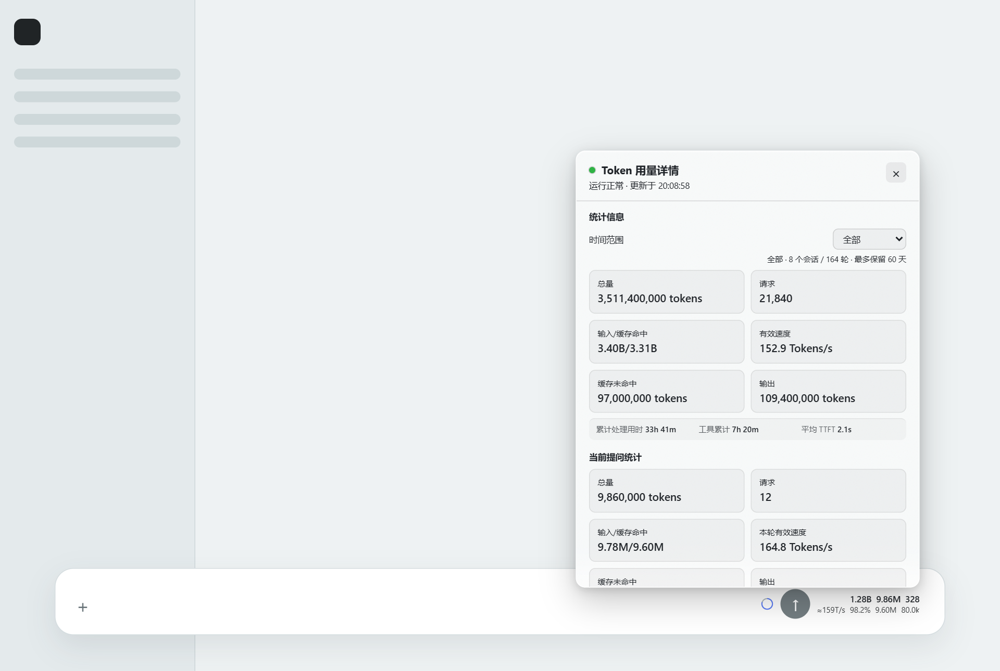
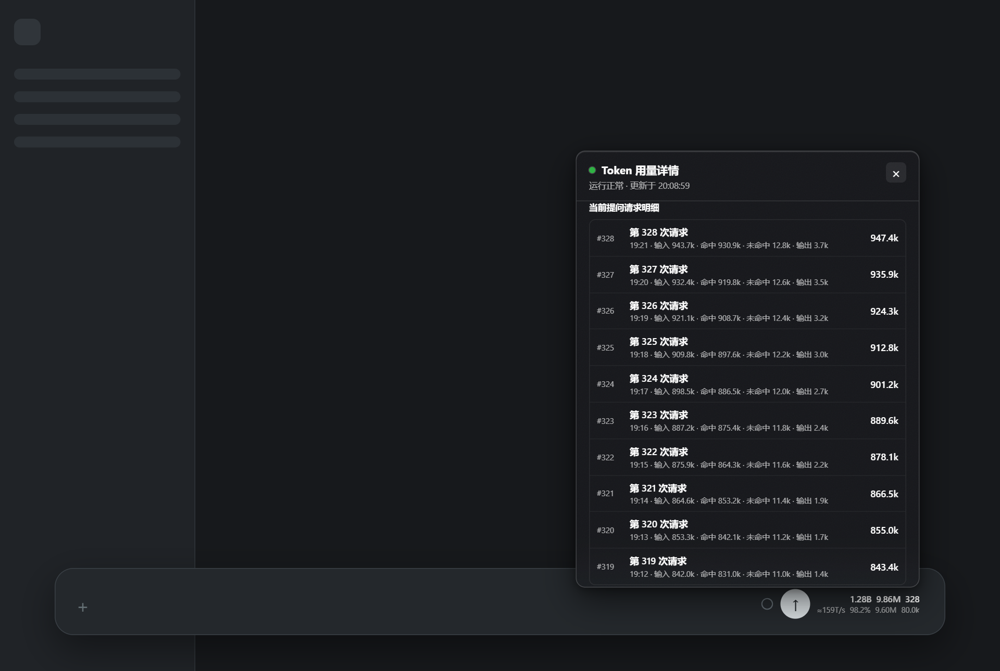
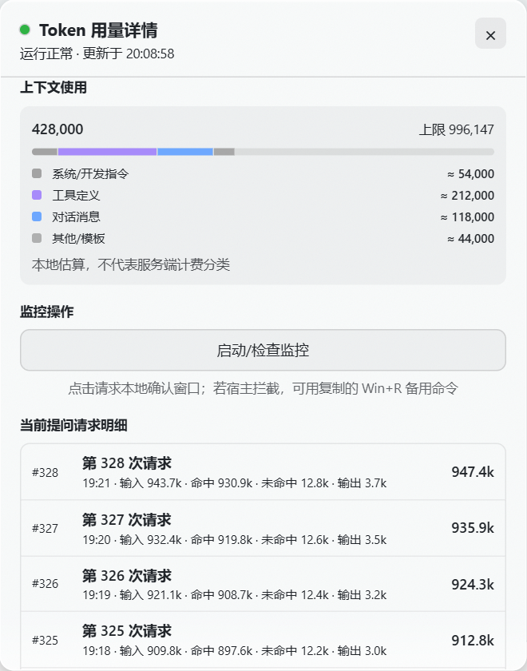

# Tokens UI For Codex

在 Codex 桌面版输入区右下角显示一套原生风格的 Token 统计 UI：
上下文用量圆圈左侧是紧凑统计条，左键单击后打开详情弹层。

- 作者：**Littps**
- 平台：Windows 10 / 11
- 客户端：Codex / ChatGPT 桌面版
- 依赖：Codex++ 用户脚本
- 许可：MIT

本项目不修改 Codex 的 React bundle，不注入键盘事件，不展示用户消息正文、会话路径或线程 ID。

## 界面预览

以下截图由当前版本和脱敏模拟数据生成，不包含真实会话正文。



浅色主题：紧凑条、时间范围、会话与当前提问统计。



深色主题：最近请求明细和按需加载入口。



上下文使用、总上限、本地估算分类以及低于 60% 阈值时的完整分段展示。

## 当前界面

紧凑统计条固定在输入区右下、上下文用量圆圈左侧：

```text
会话  当前提问  请求
≈速度  命中率  命中  输出
```

- 第一行：会话累计、当前提问累计、会话请求次数
- 第二行：生成估算速度、当前提问缓存命中率、缓存命中量、当前提问输出量
- 速度使用 `≈XXXT/s`，明确表示估算值
- 指针停留在统计条上时冻结刷新，移出后立即追上最新值

详情弹层包含六个分区：

| 分区 | 内容 |
| --- | --- |
| 统计信息 | 可按今日 / 近3天 / 近7日 / 近30日 / 全部加载本地历史；显示总量、请求、输入/缓存命中、范围有效速度、缓存未命中、输出和耗时 |
| 当前提问统计 | 总量、请求、输入/缓存命中、本轮有效速度、缓存未命中、输出；下方显示本轮总用时、工具用时和 TTFT |
| 上下文使用 | 精确已用量和上限；可选本地估算分类、完整整数和分段条 |
| 监控操作 | 手动启动和安全告警；顶部健康灯可悬浮查看错误码、原因和恢复状态 |
| 当前提问请求明细 | 默认最近 10 条，加载更多每次 +20，最多 500 条 |
| 各轮摘要 | 默认最近 10 轮，加载更多每次 +50，最多 500 轮 |

两个列表均为最新在前。未显示的条目不会进入页面负载，只有点击“加载更多”才按窗口拉取。
页面、监控协议和接收端都严格限制最多 **500** 条；更早的结构化请求与轮次摘要写入本地历史文件，
不进入 CDP payload。达到界面上限时按钮会提示完整记录已保存在本地。

“统计信息”范围可选今日、近 3 天、近 7 日、近 30 日和全部。默认“全部”，选择会保存在
浏览器本地存储中。详情关闭时不计算范围汇总；重新打开时先显示最近 24 小时内的范围缓存，
再用新签名负载原位替换。详情轮次和请求列表也会在同一页面内保留上次展开快照，避免先显示空数据。
“全部”最多覆盖本地历史保留期 60 天。详见
[docs/history-ranges.md](docs/history-ranges.md) 和
[docs/metric-scopes.md](docs/metric-scopes.md)。

紧凑条“会话”是完整线程累计；详情“全部”是本地 60 天内可定位轮次之和。首条可观测日志之前
的历史基线没有日期，只能留在完整线程累计中，因此两者不要求相等。

其他交互：

- 详情用 `role="dialog"`，支持点击外部和右上角 `×` 关闭，关闭带 110ms 退场动画
- 不注册任何键盘监听，Esc 不会关闭详情
- 浅色/深色主题跟随 Codex 宿主，主题切换在约 30ms 防抖后立即应用
- 高性能设备自动启用强磨砂；掉帧或减少透明效果时自动降级
- 健康指示灯：绿色正常、黄色等待或陈旧、红色异常；鼠标悬浮或键盘聚焦时显示错误码、
  原因、恢复状态、CDP/页面状态和最近成功时间

上下文分类是本地估算，不是服务端计费口径。系统/开发指令、工具定义、对话消息和
其他/模板开销使用完整整数并在页面标 `≈`；缺失来源显示 `--`。规则和隐私边界见
[docs/context-estimation.md](docs/context-estimation.md)。
如果未归类内容超过 60%，页面会隐藏不可靠的分类，仅保留精确已用量和上限。

## 上下文能力

- 已用量取最后一次请求的 `usage.total_tokens`，并受模型上下文上限约束；
- 上限从 `task_started`、`token_count` 和会话元数据中动态发现；
- 系统/开发指令、工具定义、对话消息和 other/template 分类是本地字符权重估算；
- 精确值与估算值在 UI 中明确区分，缺失来源显示 `--`，不伪造 0；
- “other/template”超过 60% 时隐藏不可靠的分段，只保留精确已用量和上限；
- 上下文估算只保留数值权重，不发送消息正文、会话路径或原始 ID。

完整实现边界见 [docs/context-estimation.md](docs/context-estimation.md) 和
[docs/context-and-resources.md](docs/context-and-resources.md)。

## 原组件模式资源占用

当前“原组件模式”使用常驻 PowerShell watchdog + Node 监控：

| 进程 | 观察范围 |
| --- | ---: |
| PowerShell watchdog | 工作集约 90–120 MB |
| Node 监控 | 工作集约 140–160 MB |
| 合计 | 工作集约 230–280 MB |

这是本机 2026-11-01 代表性测量，不是跨设备 SLA；会话大小、首次解析、GC 和杀软扫描都会
影响峰值。空闲 CPU 通常接近 0%，启动和首次解析时短时上升。

运行时没有第三方 npm 依赖。监控看门狗常驻但每 15 秒才检查；任务运行中 1 秒心跳、空闲
5 秒心跳，展开长列表时只在数据变化时推送。

仓库还包含 `rust-launcher/` 0.1.0 Alpha 实验组件。它只替换 PowerShell watchdog 这一层，
仍启动同一个 Node 监控；标准安装包当前继续使用 PowerShell watchdog，不会自动切换。
Rust launcher 已通过隔离的进程生命周期、计划任务安装/卸载和 doctor 测试，构建与安装说明
见 [rust-launcher/README.md](rust-launcher/README.md)。**Rust 版本没有做详细测试**：仅完成
构建、自动化隔离测试和短时单机验证，尚未完成多设备、长时间、睡眠唤醒、网络异常、企业
安全策略和跨版本升级验证。

## 环境要求

| 依赖 | 要求 |
| --- | --- |
| 操作系统 | Windows 10 / 11 |
| Codex | 桌面版；支持 MSIX 商店版与传统安装位置 |
| Codex++ | 已安装并启用用户脚本 |
| Node.js | 22 或更高；优先复用 Codex 自带运行时 |
| PowerShell | Windows PowerShell 5.1 或 PowerShell 7 |
| 管理员权限 | 不需要 |

Node 定位规则：

1. 收集 `PATH`、Codex 自带运行时和常见安装位置的全部 `node.exe`
2. 忽略 `.cmd` 包装器和低于 v22 的版本
3. 选择版本最高的 v22+ 可执行文件
4. 找不到时明确中止并提示安装

## 项目依赖与构建

运行时没有第三方 npm 依赖，只使用 Node.js 内置模块：

- `fs` / `path` / `os`
- `crypto`（HMAC-SHA256 与会话哈希）
- `child_process`
- WebSocket / fetch（Node 22+ 内置）

因此部署时不需要执行 `npm install`。源码开发需要：

- Node.js 22 或 24
- Windows PowerShell 5.1 / PowerShell 7
- 使用 `npm ci` 安装锁定的开发依赖（ESLint、Prettier、React/ReactDOM、Playwright）
- React/ReactDOM 暂未接入当前原生 JavaScript 用户脚本；若迁移 UI，必须将框架打包进独立产物
- Playwright 用于本地隔离页 `test:auth-ui` 与实机 `test:live`；实机测试通过 CDP 连接 Codex 桌面版

项目元数据以 `package.json` 和插件 `.codex-plugin/plugin.json` 为准；CI 会同时测试 Node 22 与 24。

## 安装

发布包的目录、验证和卸载说明见 [DEPLOYMENT.md](DEPLOYMENT.md)。

### 一键安装

双击部署包根目录的 `install.bat`，或运行：

```powershell
powershell.exe -NoProfile -ExecutionPolicy Bypass -File ".\install.ps1"
```

安装器依次执行：

1. 检查 Windows、Node、Codex 桌面版、Codex++、用户脚本总开关和 `codex` CLI
2. 先停止旧监控，避免旧 schema 继续向新面板推送
3. 备份并安装 Codex++ 用户脚本，校验 SHA-256
4. 按脚本内容停用历史面板脚本，避免页面出现两条统计条
5. 注册或刷新 `tokens-ui-for-codex@tokens-ui-for-codex-local`
6. 注册用户级计划任务并立即启动一次监控
7. 复核任务、插件、用户脚本和监控进程；任一必需项失败则返回非 0

### 源码包安装

源码压缩包不要求预先包含 `plugins/` 布局。`install.ps1` 会在：

```text
<CODEX_HOME>\tokens-ui-for-codex\install-stage\
```

生成新 staging 布局，校验关键文件与哈希后再切换目录并注册插件。

### 手动安装

```powershell
Copy-Item ".\plugins\tokens-ui-for-codex\tokens-ui-for-codex-panel.js" "$env:APPDATA\Codex++\user_scripts\" -Force
codex plugin marketplace add "<包根>"
codex plugin add tokens-ui-for-codex@tokens-ui-for-codex-local
powershell.exe -NoProfile -ExecutionPolicy Bypass -File ".\plugins\tokens-ui-for-codex\install-autostart.ps1"
```

## 启动与恢复

计划任务名：`tokens-ui-for-codex-monitor`

- 触发：当前用户登录时启动一次
- 动作：`powershell.exe -WindowStyle Hidden → monitor-watchdog.ps1 -Resident`
- watchdog 常驻并在同一进程内每 15 秒检查；异常时拉起 Node
- 重复实例：任务 `IgnoreNew` + 用户级 guard lock + 进程交叉检查
- 卡死判定：启动宽限 120 秒，心跳停滞需连续两次确认
- 原地升级：超过启动宽限且无有效心跳的旧监控会在确认脚本路径后受控迁移一次
- 失败恢复：1、2、5、10、15 分钟指数退避
- 运行级别：Limited，不需要管理员权限
- 资源取舍：无常驻任务闪烁，但增加一个低频 PowerShell supervisor

默认策略是**一个 Windows 用户只运行一个监控**。不同状态目录或锁路径也不能绕过
用户级 guard；`--allow-multi-monitor` 仅供隔离测试。

监控停止后 watchdog 会自动拉起。手动入口有两种：

1. 详情弹层“启动/检查监控”优先请求本地确认协议，并复制 Win+R 备用命令
2. 从开始菜单运行“Tokens UI For Codex - 启动监控”

手动入口会先执行全局实例检查。若已有存活实例就退出；否则打开 Unicode
PowerShell 确认窗口，只有输入 `Y` 才启动。页面不会静默启动本地进程。

## 数据链路

```text
本地 Codex 会话 JSONL
  → token-stats.mjs 增量解析与统计
  → 本机 CDP（动态端口）
  → 签名 schema v4 / auth v2 负载
  → Codex++ 用户脚本验签
  → 原生风格统计条与详情增量渲染
```

关键机制：

- 会话日志只读取结构化数值，不复制、不展示、不外传正文
- 长会话分片自动归组、合并、按 `(timestamp, ordinal)` 排序
- 会话候选需稳定且存在对应 rollout 后才切换；新对话不会猜测到旧文件
- 增量解析器记录偏移、半行缓存和前缀指纹；截断、重建、同长度替换会重建基线
- 单次 `--thread` 与 watch 使用相同的全分片合流路径
- 两代日志格式统一合并，累计下降按 reset 处理，不做单调递增假设
- legacy 自身去重包含完整 input/output/cached 构成
- 现代格式后的 legacy 记录通过本轮线程累计基线差补齐当前轮

统计口径以 [docs/F1-merge-spec.md](docs/F1-merge-spec.md) 为准。

## 速度口径

紧凑条：

- 显示 `≈XXXT/s`
- 使用最近最多 5 个有效请求样本
- 先以中位数抑制单条尖峰，再用 MAD 过滤极端离群值
- 连续 3 个窄分布的高速/低速样本允许建立新速度区间
- 少于 3 个有效样本时显示 `--T/s`，不展示单条尖峰
- 生成耗时使用重叠生成区间并集，避免条目时长重复累加
- 仍明确标记为估算值，不声称是服务商侧纯解码速度

详情页：

- 有效速度 = 输出 tokens ÷（整轮耗时 − 工具执行耗时）
- 当前提问显示本轮有效速度
- 会话累计使用最近 25 个高/中置信度轮次，按输出和耗时加权
- 速度标题同时显示本轮墙钟平均速度；墙钟值只使用 output tokens，不使用上下文累计量
- 输出 tokens 已包含 reasoning、格式与工具结构，不重复添加 reasoning tokens

## 推送节奏

| 状态 | 行为 |
| --- | --- |
| 数据变化 | 立即推送 |
| 任务运行中 | 1 秒心跳 |
| 空闲 | 5 秒心跳 |
| 详情展开且加载长列表 | 不参与心跳，仅在数据/健康/窗口变化时推送 |

详情展开时，rollout 解析结果一旦变化仍会立即推送；不需要恢复高频心跳。

## 安全与隐私

- 页面协议为**签名-only schema v4 / auth v2**
- HMAC 只做完整性和来源校验，不提供加密
- 每次监控启动生成随机 256-bit 会话密钥
- HMAC-SHA256 签名覆盖完整负载、认证版本、keyId、时间戳、nonce 与 seq
- 拒绝无 auth、坏 MAC、超过 30 秒、nonce 重放、seq 倒退和旧 schema
- 密钥只在一次同步事件派发期间短暂暴露，页面捕获后立即删除全局入口
- 验证前深拷贝负载，验证与应用使用同一快照
- CDP 端口默认 `--port auto`，从 `ChatGPT.exe` 命令行发现；`--port <n>` 可覆盖
- 页面负载不含路径、线程 ID、消息正文、Token、密钥或凭据
- 本地历史归档同样不含消息正文、路径或原始线程标识，只使用会话哈希
- 健康快照和日志属于本机诊断数据，迁移时不建议复制
- HMAC 用于基础完整性和防误注入，不承诺抵御拥有当前用户同等权限的本机恶意程序

详细隐私边界见 [README.agent.md](README.agent.md) 与
[MIGRATION-FOR-AGENTS.md](MIGRATION-FOR-AGENTS.md)。认证格式与信任边界见
[docs/auth-v2.md](docs/auth-v2.md)。

## 健康状态与日志

状态目录：

```text
<CODEX_HOME>\tokens-ui-for-codex\state\
├─ logs\watch-YYYY-MM-DD.log
├─ history\sessions\<sessionHash>\
│  ├─ requests-YYYYMM*.jsonl
│  └─ turns.json
├─ monitor-health.json
├─ monitor-heartbeat.json
├─ watchdog-state.json
├─ watchdog.lock
├─ autostart-state.json
└─ last-summary.json
```

实际路径以插件目录中的 `runtime-paths.json` 为准；解析优先级和覆盖方式见
[docs/runtime-paths.md](docs/runtime-paths.md)。

常用状态：

| 状态 | 含义 |
| --- | --- |
| `starting` | 刚启动 |
| `healthy` | 正常 |
| `waiting-for-cdp` | 本机 CDP 不通 |
| `waiting-for-page` | 页面或对话尚未就绪 |
| `waiting-for-data` | 会话暂无用量数据 |
| `stale-data` | 数据超过时效或会话文件长期无新增 |
| `target-selection-required` | 多窗口且无法唯一确定焦点 |
| `protocol-mismatch` | 页面与监控协议版本不一致 |
| `failed` | 监控或负载校验失败 |

健康文件每个巡检周期更新 `lastSuccessAt` 和 mtime。独立 heartbeat 每 10 秒推进
`heartbeatSeq`，watchdog 只根据该心跳判断进程是否卡死。

本地历史规则：

- 只保存结构化数值、时间标签、轮次索引和请求索引
- 不保存消息正文、会话路径、线程 ID、response ID 或 turn ID
- 从当前时间起保留 **60 天**
- 请求文件超过 32MB 自动分段
- 每 6 小时检查并清理过期历史
- 标准卸载保留历史；`-Full` 会删除历史

## 排障

| 现象 | 检查顺序 |
| --- | --- |
| 没有统计条 | Codex++ 是否运行；用户脚本总开关；用户脚本是否唯一；重载页面 |
| 统计条等待数据 | `monitor-health.json`、日志、监控进程、Codex CDP 端口 |
| 页面提示协议不匹配 | 用户脚本、插件 cache 和监控脚本是否来自同一版本 |
| 数字不增长 | 定位失败/分片预警；会话文件 mtime；是否切换到了空白新对话 |
| 速度不变化 | 数据源只在 Codex 写入用量记录时更新，心跳不产生新数据 |
| 多窗口异常 | 让目标窗口成为唯一焦点，或使用 `--target <ID>` |
| 中文路径安装失败 | 确认四个 PS1 为 UTF-8 BOM、VBS 为 UTF-16LE |

只读检查命令：

```powershell
Get-ScheduledTask -TaskName tokens-ui-for-codex-monitor | Format-List State
Get-CimInstance Win32_Process -Filter "Name='node.exe'" |
  Where-Object { $_.CommandLine -match 'token-stats\.mjs' } |
  Select-Object ProcessId, CommandLine
node .\runtime-paths.mjs
Get-Content ".\runtime-paths.json" -Raw -Encoding UTF8
```

## 测试与验证

```powershell
npm ci
npm run check
npm run screenshots:readme
npm test
npm run test:auth-ui
powershell -NoProfile -ExecutionPolicy Bypass -File scripts\verify-watchdog.ps1
npm run format:check
node scripts\golden-baseline.mjs --check
node scripts\verify-live.mjs
npm run test:live
node scripts\verify-sync.mjs --deploy "<部署根>" --zip "<安装包>"
```

默认是失败关闭的严格模式；开发期只检查现有副本时可加 `--allow-partial`，
发布验收不得使用该参数。

当前基线：

- 单元测试：87 项
- watchdog 隔离进程测试：通过
- 本地隔离页 auth UI：5 项
- 固定合成快照：0 不一致；真实本机 Golden corpus 未随源码发布
- `verify-live`：29 项，部署当前源码后实跑通过
- 实机 Playwright：19 个用例；当前 17 通过，2 个真实输入用例默认跳过
- 时序与重启场景要求至少 5 轮实机复测

## 更新、备份与恢复

更新前备份：

- 源码目录
- 正式部署目录
- 插件 cache
- Codex++ 用户脚本
- 状态目录
- Codex/Codex++ 配置（如需要）

更新顺序：

1. 停止旧监控
2. 同步文件
3. 刷新用户脚本
4. 重新注册插件
5. 启动新监控
6. 重载 Codex 页面
7. 执行同步校验与页面验收

安装器会在启动新实例前停止所有旧 `token-stats.mjs --watch` 进程。

## 卸载

```powershell
# 保留状态、日志和用户脚本
powershell.exe -NoProfile -ExecutionPolicy Bypass -File ".\plugins\tokens-ui-for-codex\uninstall-autostart.ps1"

# 完全卸载：任务、进程、状态、用户脚本及备份、插件与缓存
powershell.exe -NoProfile -ExecutionPolicy Bypass -File ".\plugins\tokens-ui-for-codex\uninstall-autostart.ps1" -Full
```

卸载后脚本会执行残留自检；仍有任务、进程、脚本、插件或状态残留时返回非 0。
部署包目录本身需要手动删除。

## 已知边界

- 仅支持 Windows + Codex 桌面版 + Codex++
- 页面锚点依赖 Codex 当前 DOM 的可访问性标签；Codex 大版本更新后可能需要调整选择器
- 当前无法从 rollout 事件获得逐 token/chunk 时间线，因此紧凑条速度是估算值
- watchdog 只判断进程存活，不判断 CDP/页面/数据是否暂时不可用
- 新会话身份需要稳定确认，极端情况下切到新对话会延迟约 2.5–5 秒
- 多窗口需要唯一焦点；无法唯一判定时要求显式 `--target`
- 企业环境禁用了计划任务、用户脚本或 CDP 时，需要改用有权限的部署方式

## 许可

MIT License · Copyright (c) 2026 **Littps**
